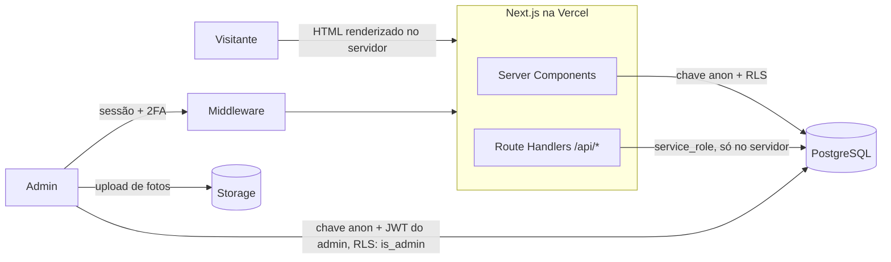
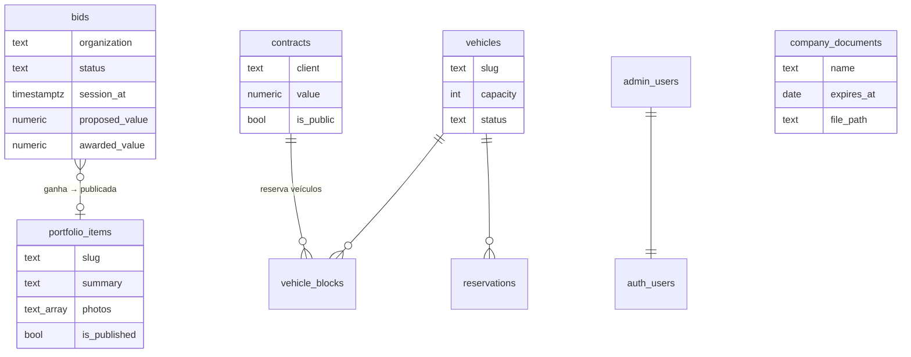

# Amav's Turismo

Sistema de uma empresa de transporte de passageiros de Brasília que vive principalmente de **licitações**: ela disputa pregões e dispensas do governo e presta o serviço para órgãos como o Exército e conselhos federais.

O projeto substituiu um WordPress de 2019 e tem duas partes:

- **Painel (uso interno):** controle das licitações em disputa (sessões, propostas, resultado e taxa de sucesso), certidões de habilitação com alerta de vencimento, portfólio de serviços prestados, contratos, frota com agenda e QR Code, e orçamentos de fretamento.
- **Site público:** vitrine dos serviços já prestados ao governo, com fotos e atestados de capacidade técnica, frota e contato para pregoeiros e fiscais de contrato.

**Stack:** Next.js 14 (App Router) · TypeScript · Node.js · PostgreSQL (Supabase) · Row Level Security · Zod · Vitest · Tailwind · Vercel · GitHub Actions

---

## Arquitetura



Três formas de acessar o banco, cada uma com um nível de confiança:

| Quem | Credencial | O que consegue |
|---|---|---|
| Visitante (navegador) | chave `anon` | Ler catálogo (veículos, galeria, portfólio publicado, contratos marcados como públicos com só colunas não sensíveis). Nada mais. |
| Admin (navegador) | `anon` + JWT da sessão | Tudo, mas **só se** o usuário estiver em `admin_users` (função `is_admin()` nas policies). |
| Servidor (Route Handlers e Server Components) | `service_role` | Grava formulários públicos depois de validar e calcula números agregados (ex.: licitações vencidas). Ao navegador só chega o resultado. A chave nunca sai do servidor. |

---

## API

| Método | Rota | Acesso | O que faz |
|---|---|---|---|
| `GET` | `/api/disponibilidade` | público | Veículos e **períodos ocupados** (só datas e tipo). Usada pelo formulário de orçamento e pelo calendário de cada veículo. Cache de 60 s na CDN. |
| `POST` | `/api/leads` | público | Pedido de orçamento de fretamento. Valida com Zod, rate limit por IP e honeypot antes de gravar. |
| `POST` | `/api/admin/check-rate-limit` | login | Verifica bloqueio por força bruta antes de tentar o login. |
| `POST` | `/api/admin/log-attempt` | login | Registra tentativa. Sucesso só é gravado se a requisição tiver sessão válida do mesmo e-mail. |
| `GET` | `/auth/callback` | público | Troca o código do Supabase Auth por sessão (recuperação de senha). |

Todas as rotas que escrevem verificam a origem da requisição (proteção extra contra CSRF além do cookie `SameSite=Lax`).

As telas do painel falam direto com o Postgres pelo SDK do Supabase, com o JWT do admin. Quem autoriza é o banco (RLS), não o front-end: mesmo que alguém chame a API REST do Supabase na mão, sem estar em `admin_users` recebe lista vazia.

## Modelo de dados (principais tabelas)



`company_documents.file_path` aponta para um bucket **privado**; o arquivo só abre por URL assinada de 60 segundos gerada para um admin logado.

---

## Decisões que valem explicar

### Segurança: o que encontrei e como corrigi

Numa revisão do projeto encontrei problemas reais, que um visitante comum conseguia explorar só com a chave pública do Supabase (que fica no navegador por design):

1. **Cadastro aberto = acesso de admin.** As policies liberavam tudo para `authenticated`, e o cadastro público de contas estava ligado. Qualquer pessoa podia criar uma conta e ler nome e telefone de clientes.
   *Correção:* tabela `admin_users` + função `is_admin()` (`security definer`) em todas as policies, lista `ADMIN_EMAILS` no middleware e cadastro desligado.

2. **Vazamento pelo formulário de orçamento.** Para calcular disponibilidade, o navegador baixava as tabelas `reservations` e `vehicle_blocks` inteiras, com nome do cliente e observações internas. Um deles aparecia na tela como "Reserva: Fulano".
   *Correção:* a regra continua no cliente (para a resposta ser instantânea), mas os dados vêm de `/api/disponibilidade`, que devolve só `vehicle_id`, datas e tipo. As tabelas deixaram de ser legíveis por `anon`.

3. **Valores de contratos públicos.** Bastava uma chamada REST para ler valor e observações de qualquer contrato ativo.
   *Correção:* `GRANT SELECT` por coluna para o papel `anon` (só código, órgão, modalidade, datas e status) e policy que exige `is_public`.

4. **2FA que não era exigido.** O admin podia cadastrar TOTP, mas o login nunca pedia o código.
   *Correção:* o login verifica o nível de autenticação (`aal1`/`aal2`) e pede o código. O middleware bloqueia qualquer rota do painel enquanto a sessão estiver em `aal1` e houver fator cadastrado. Com `REQUIRE_ADMIN_MFA=true`, o 2FA passa a ser obrigatório.

5. **Bloqueio de login usado como ataque.** O bloqueio após 5 erros era por e-mail, e a rota que registra erros não tinha autenticação. Um script podia manter o dono da conta trancado para fora indefinidamente.
   *Correção:* o bloqueio passou a ser por **e-mail + IP** (5 falhas), com um teto global por e-mail (20) para ataques distribuídos. Quem forja falhas só bloqueia o próprio IP.

6. **Redirect aberto** em `/auth/callback?next=//site-malicioso.com`, útil para phishing com um link do domínio real. Corrigido e coberto por teste.

Outros: CSP sem `unsafe-eval` em produção, `frame-ancestors 'none'`, HSTS, `X-Robots-Tag: noindex` no painel, upload restrito por MIME no Storage e metadados EXIF/GPS removidos das fotos antes de publicar.

A migration com tudo isso está em [`supabase/migrations/2026-10-27_security_hardening.sql`](amavs-next/supabase/migrations/2026-10-27_security_hardening.sql) e é idempotente: recria as policies do zero em vez de depender do estado anterior.

### Disponibilidade da frota

[`lib/availability.ts`](amavs-next/lib/availability.ts) cruza o período pedido com três fontes de bloqueio (manutenção, bloqueios manuais e reservas) usando sobreposição de intervalos fechados, com suporte a bloqueio por tempo indeterminado. Depois ordena os veículos por uma pontuação simples: indisponível pesa mais que pequeno demais, que pesa mais que lugares sobrando. Para 20 passageiros, sugere o micro-ônibus de 28 lugares antes do ônibus de 46.

### QR Code que não pode quebrar

Cada veículo tem um QR Code colado na lataria, que vai ficar lá por anos. O QR aponta para `/frota/{slug}` e não para o UUID. O slug é gerado uma vez e nunca muda, então o código impresso continua funcionando mesmo se o banco for migrado ou o veículo for recadastrado.

### Gestão de licitações

O ciclo de vida de uma licitação é uma máquina de estados simples (`prospeccao → em_analise → proposta_enviada → aguardando_resultado → ganha | perdida`, além de `desistencia` e `cancelada`), validada por `CHECK` no banco. Os indicadores do painel (em andamento, sessões nos próximos 7 dias, taxa de sucesso e valor ganho no ano) saem de uma função pura, `bidStats` em [`lib/licitacoes.ts`](amavs-next/lib/licitacoes.ts), coberta por testes. Uma escolha consciente: a taxa de sucesso é `ganhas / (ganhas + perdidas)`. Desistências e licitações em aberto não entram, e sem nenhum resultado ela é `null`, não 0%.

Quando uma licitação é ganha, um clique cria o rascunho do item de portfólio, que a equipe completa com fotos antes de publicar no site.

### Certidões com validade

Em licitação, certidão vencida no dia da sessão inabilita a empresa. `documentStatus` em [`lib/documents.ts`](amavs-next/lib/documents.ts) classifica cada documento em válido, vencendo (15 dias antes) ou vencido, comparando só datas de calendário para não depender de fuso horário.

### Um bug de fuso horário

`new Date('2016-10-24')` é meia-noite **UTC**; formatado em Brasília (UTC-3), vira 23/10. Isso deslocava em um dia todas as datas puras do sistema (contratos, viagens, atestados). A correção trata `YYYY-MM-DD` como data local, e o teste roda com `TZ=America/Sao_Paulo` fixo, porque em UTC (o fuso do CI) o bug não aparece.

---

## Testes e CI

```bash
npm test          # Vitest: disponibilidade, indicadores de licitação, validade de certidões, validação, datas
npm run typecheck
```

O GitHub Actions roda typecheck, testes e build a cada push e PR ([`.github/workflows/ci.yml`](.github/workflows/ci.yml)).

---

## Documentação

- [`docs/GUIA_DE_ESTUDO.md`](docs/GUIA_DE_ESTUDO.md): como o sistema funciona por dentro, camada por camada.
- [`docs/NOVA_MAQUINA.md`](docs/NOVA_MAQUINA.md): rodar o projeto em outro computador.
- [`amavs-next/README.md`](amavs-next/README.md): instalação completa e primeiro admin.

## Rodando localmente

Requisitos: Node 20+ e um projeto no Supabase.

```bash
cd amavs-next
npm install
cp .env.example .env.local     # preencha com as chaves do seu projeto Supabase
npm run dev                    # http://localhost:3000
```

Banco: rode `supabase/schema.sql` e depois os arquivos de `supabase/migrations/` em ordem de data, no SQL Editor do Supabase. O passo a passo completo, incluindo a criação do primeiro admin, está em [`amavs-next/README.md`](amavs-next/README.md).

---

## Estrutura

```
amavs-next/
├── app/
│   ├── (public)/          site (home, setor público, frota, orçamento…)
│   ├── admin/             painel: licitações, documentos, portfólio, frota…
│   └── api/               route handlers
├── components/            seções do site, layout e componentes do painel
├── lib/
│   ├── licitacoes.ts      etapas e indicadores das licitações (bidStats)
│   ├── documents.ts       validade das certidões (documentStatus)
│   ├── portfolio.ts       serviços prestados + fallback estático
│   ├── availability.ts    regra de disponibilidade e ranking da frota
│   ├── validation.ts      schemas Zod das rotas públicas
│   ├── supabase-admin.ts  cliente service_role (só servidor)
│   ├── rate-limit.ts
│   └── __tests__/
├── middleware.ts          sessão, lista de admins e 2FA
└── supabase/              schema e migrations
amavs-v2/                  versão anterior em PHP 8 + MySQL, mantida como histórico
```

---

## Limitações conhecidas e próximos passos

- **Rate limit em memória.** Cada instância serverless tem seu contador. Para o volume atual é suficiente; o próximo passo seria um store compartilhado (Redis/Upstash) ou uma tabela com janela deslizante no Postgres.
- **Testes cobrem a lógica pura.** As rotas e as policies RLS ainda não têm testes de integração. A ideia é subir um Postgres em container no CI e testar as policies com os papéis `anon` e `authenticated`.
- **Monitoramento de editais.** Consultar a API pública do PNCP (Portal Nacional de Contratações Públicas) num job agendado, filtrar pregões de transporte de passageiros e criar licitações em `prospeccao` automaticamente.
- **Alertas por e-mail.** Um cron diário avisando sessões do dia seguinte e certidões que vencem na semana.
