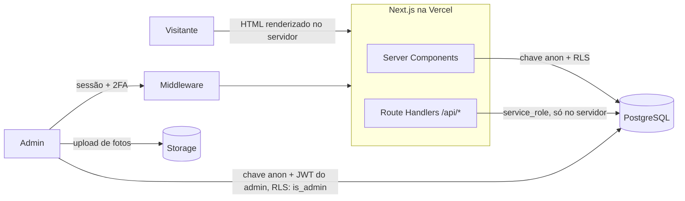

# Amav's Turismo

Site e painel administrativo de uma empresa de transporte de passageiros de Brasília que hoje trabalha principalmente com **contratos públicos** (pregões, dispensas e adesões a ata).

O projeto substituiu um WordPress de 2019. A parte pública apresenta a empresa para pregoeiros e setores de compras (atestados de capacidade técnica, documentação e formulário de pedido de proposta). O painel é a ferramenta da equipe para frota, agenda dos veículos, contratos, pedidos de proposta, orçamentos e galeria.

**Stack:** Next.js 14 (App Router) · TypeScript · Node.js · PostgreSQL (Supabase) · Row Level Security · Zod · Vitest · Tailwind · Vercel · GitHub Actions

---

## Arquitetura



Três formas de acessar o banco, cada uma com um nível de confiança:

| Quem | Credencial | O que consegue |
|---|---|---|
| Visitante (navegador) | chave `anon` | Ler catálogo (veículos, galeria, contratos marcados como públicos, só colunas não sensíveis). Nada mais. |
| Admin (navegador) | `anon` + JWT da sessão | Tudo, mas **só se** o usuário estiver em `admin_users` (função `is_admin()` nas policies). |
| Servidor (Route Handlers) | `service_role` | Grava formulários públicos depois de validar e devolve ao navegador apenas dados já filtrados. A chave nunca chega ao cliente. |

---

## API

| Método | Rota | Acesso | O que faz |
|---|---|---|---|
| `GET` | `/api/disponibilidade` | público | Veículos e **períodos ocupados** (só datas e tipo). Usada pelo formulário de orçamento e pelo calendário de cada veículo. Cache de 60 s na CDN. |
| `POST` | `/api/licitacoes` | público | Pedido de proposta de um órgão. Valida com Zod, aplica rate limit por IP e honeypot, grava em `bid_requests` e devolve um protocolo (`LIC-20261027-K3F9`). |
| `POST` | `/api/leads` | público | Pedido de orçamento particular. Mesmo esquema de validação. |
| `POST` | `/api/admin/check-rate-limit` | login | Verifica bloqueio por força bruta antes de tentar o login. |
| `POST` | `/api/admin/log-attempt` | login | Registra tentativa. Sucesso só é gravado se a requisição tiver sessão válida do mesmo e-mail. |
| `GET` | `/auth/callback` | público | Troca o código do Supabase Auth por sessão (recuperação de senha). |

Todas as rotas que escrevem verificam a origem da requisição (proteção extra contra CSRF além do cookie `SameSite=Lax`).

---

## Decisões que valem explicar

### Segurança: o que encontrei e como corrigi

Numa revisão do projeto encontrei problemas reais, que um visitante comum conseguia explorar só com a chave pública do Supabase (que fica no navegador por design):

1. **Cadastro aberto = acesso de admin.** As policies liberavam tudo para `authenticated`, e o cadastro público de contas estava ligado. Qualquer pessoa podia criar uma conta e ler nome e telefone de clientes.
   *Correção:* tabela `admin_users` + função `is_admin()` (`security definer`) em todas as policies, lista `ADMIN_EMAILS` no middleware e cadastro desligado.

2. **Vazamento pelo formulário de orçamento.** Para calcular disponibilidade, o navegador baixava as tabelas `reservations` e `vehicle_blocks` inteiras, com nome do cliente e observações internas. Um deles aparecia na tela como "Reserva: Fulano".
   *Correção:* a regra continua no cliente (para a resposta ser instantânea), mas os dados vêm de `/api/disponibilidade`, que devolve só `vehicle_id`, datas e tipo. As tabelas deixaram de ser legíveis por `anon`.

3. **Valores de contratos públicos.** Bastava uma chamada REST para ler valor e observações de qualquer contrato ativo.
   *Correção:* `GRANT SELECT` por coluna para o papel `anon` (só código, órgão, modalidade, datas e status) e policy que exige `is_public`.

4. **2FA que não era exigido.** O admin podia cadastrar TOTP, mas o login nunca pedia o código.
   *Correção:* o login verifica o nível de autenticação (`aal1`/`aal2`) e pede o código. O middleware bloqueia qualquer rota do painel enquanto a sessão estiver em `aal1` e houver fator cadastrado. Com `REQUIRE_ADMIN_MFA=true`, o 2FA passa a ser obrigatório.

5. **Bloqueio de login usado como ataque.** O bloqueio após 5 erros era por e-mail, e a rota que registra erros não tinha autenticação. Um script podia manter o dono da conta trancado para fora indefinidamente.
   *Correção:* o bloqueio passou a ser por **e-mail + IP** (5 falhas), com um teto global por e-mail (20) para ataques distribuídos. Quem forja falhas só bloqueia o próprio IP.

6. **Redirect aberto** em `/auth/callback?next=//site-malicioso.com`, útil para phishing com um link do domínio real. Corrigido e coberto por teste.

Outros: CSP sem `unsafe-eval` em produção, `frame-ancestors 'none'`, HSTS, `X-Robots-Tag: noindex` no painel, upload restrito por MIME no Storage e metadados EXIF/GPS removidos das fotos antes de publicar.

A migration com tudo isso está em [`supabase/migrations/2026-10-27_security_hardening.sql`](amavs-next/supabase/migrations/2026-10-27_security_hardening.sql) e é idempotente: recria as policies do zero em vez de depender do estado anterior.

### Disponibilidade da frota

[`lib/availability.ts`](amavs-next/lib/availability.ts) cruza o período pedido com três fontes de bloqueio (manutenção, bloqueios manuais e reservas) usando sobreposição de intervalos fechados, com suporte a bloqueio por tempo indeterminado. Depois ordena os veículos por uma pontuação simples: indisponível pesa mais que pequeno demais, que pesa mais que lugares sobrando. Para 20 passageiros, sugere o micro-ônibus de 28 lugares antes do ônibus de 46.

### QR Code que não pode quebrar

Cada veículo tem um QR Code colado na lataria, que vai ficar lá por anos. O QR aponta para `/frota/{slug}` e não para o UUID. O slug é gerado uma vez e nunca muda, então o código impresso continua funcionando mesmo se o banco for migrado ou o veículo for recadastrado.

### Pedidos de proposta

Órgãos públicos raramente usam formulário de orçamento comum: eles têm número de processo, data de sessão e edital. Por isso existe um fluxo separado (`bid_requests`) com modalidade da Lei 14.133/2021, data da sessão e link do edital. No painel, pedidos com sessão em até 5 dias aparecem destacados.

---

## Testes e CI

```bash
npm test          # Vitest: disponibilidade, validação das APIs, redirect, rate limit
npm run typecheck
```

O GitHub Actions roda typecheck, testes e build a cada push e PR ([`.github/workflows/ci.yml`](.github/workflows/ci.yml)).

---

## Rodando localmente

Requisitos: Node 20+ e um projeto no Supabase.

```bash
cd amavs-next
npm install
cp .env.example .env.local     # preencha com as chaves do seu projeto Supabase
npm run dev                    # http://localhost:3000
```

Banco: rode `supabase/schema.sql` e depois os arquivos de `supabase/migrations/` em ordem de data, no SQL Editor do Supabase. O passo a passo completo, incluindo a criação do primeiro admin, está em [`amavs-next/README.md`](amavs-next/README.md).

---

## Estrutura

```
amavs-next/
├── app/
│   ├── (public)/          páginas do site (home, licitações, frota, orçamento…)
│   ├── admin/             painel (protegido pelo middleware)
│   └── api/               route handlers
├── components/            seções do site, layout e componentes do painel
├── lib/
│   ├── availability.ts    regra de disponibilidade e ranking
│   ├── validation.ts      schemas Zod das rotas públicas
│   ├── supabase-admin.ts  cliente service_role (só servidor)
│   ├── rate-limit.ts
│   ├── atestados.ts       atestados de capacidade técnica da empresa
│   └── __tests__/
├── middleware.ts          sessão, lista de admins e 2FA
└── supabase/              schema e migrations
amavs-v2/                  versão anterior em PHP 8 + MySQL, mantida como histórico
```

---

## Limitações conhecidas e próximos passos

- **Rate limit em memória.** Cada instância serverless tem seu contador. Para o volume atual é suficiente; o próximo passo seria um store compartilhado (Redis/Upstash) ou uma tabela com janela deslizante no Postgres.
- **Testes cobrem a lógica pura.** As rotas e as policies RLS ainda não têm testes de integração. A ideia é subir um Postgres em container no CI e testar as policies com os papéis `anon` e `authenticated`.
- **E-mail de notificação.** Hoje o pedido de proposta aparece no painel e o órgão é direcionado ao WhatsApp. Falta notificar a equipe por e-mail quando chega um pedido novo.
- **Monitoramento de editais.** Consultar a API do PNCP (Portal Nacional de Contratações Públicas) por pregões de transporte no DF e listar oportunidades no painel.
